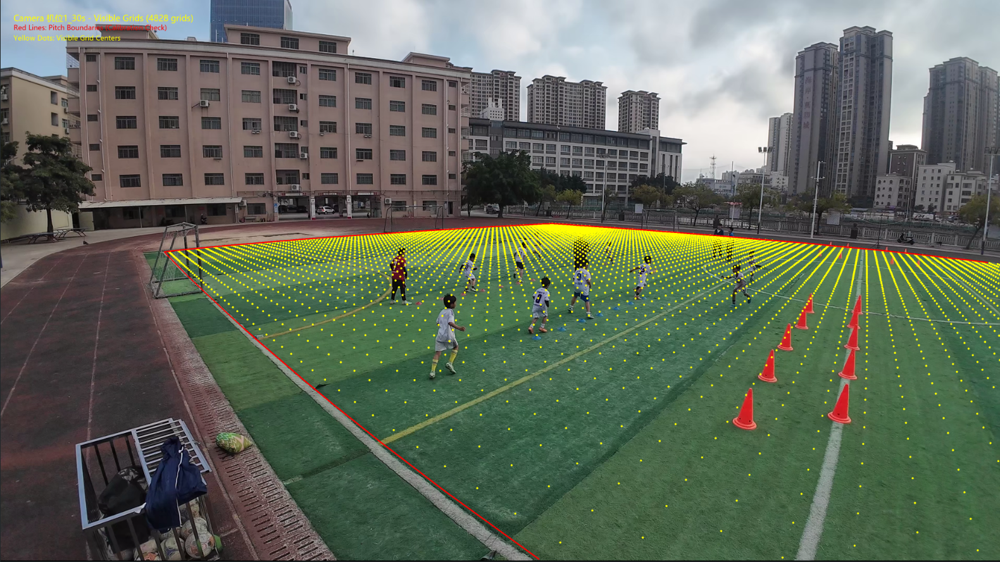
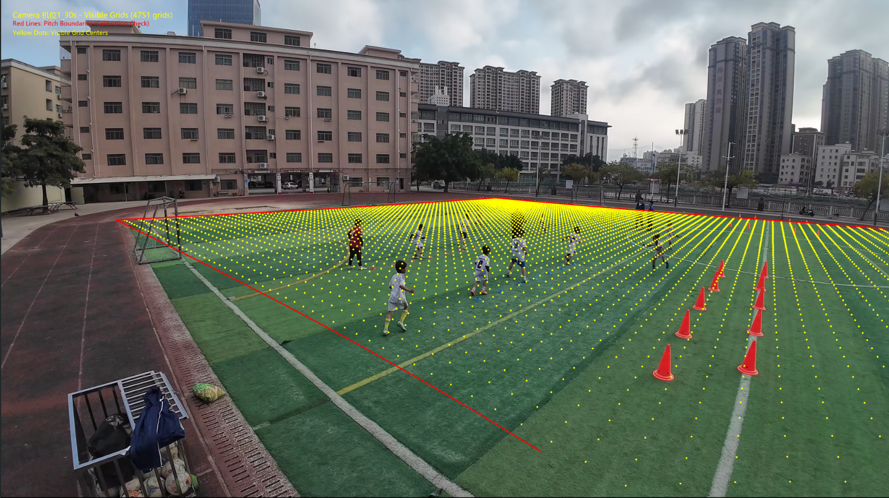
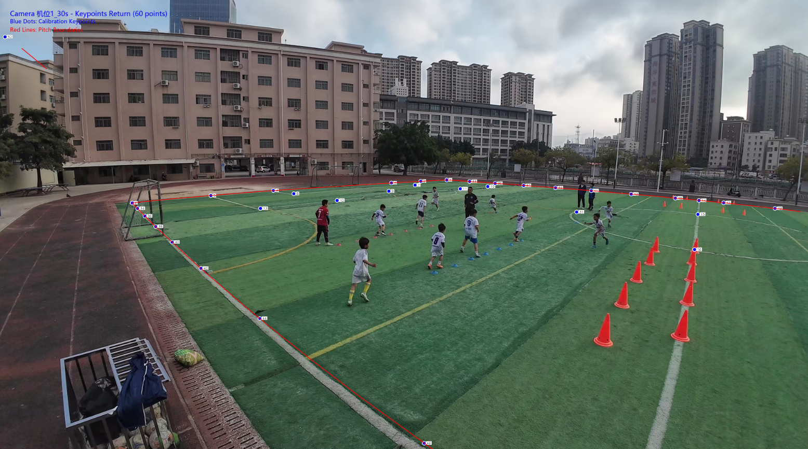
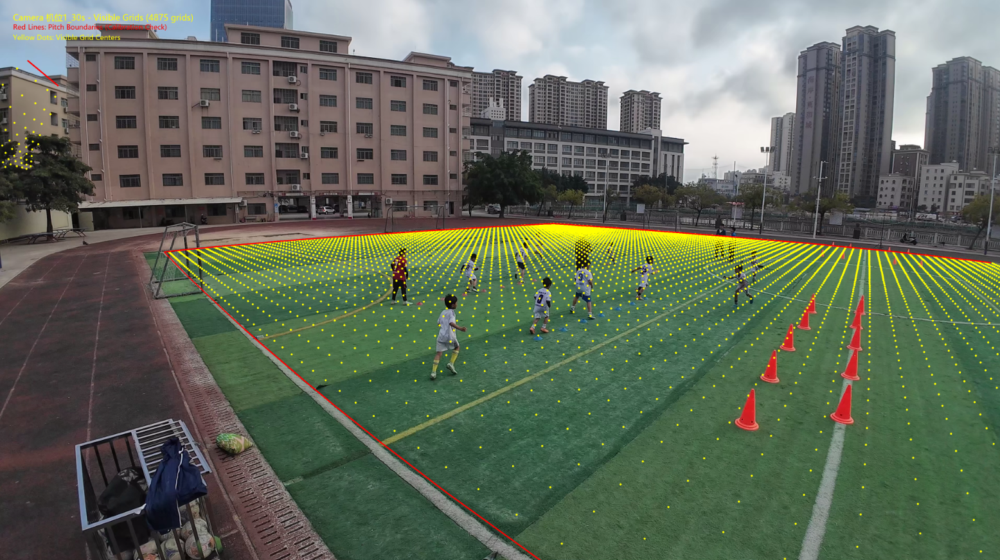

# 相机标定

本项目隶属于MCS的一部分，是一个用于足球场景的单目相机标定的工具集。该项目能够将视频画面中的像素坐标映射到真实的物理球场坐标系中，支持多种球场规格配置，并内置了标记物测量、相机畸变去畸变等功能。

## 环境依赖

请确保安装了 python 3.10 ，再运行以下代码：

```bash
pip install -r requirements.txt
```

## 快速开始

### 1. 配置项目
修改根目录下的 `config.yaml` 文件：

```yaml
dir_path: "."
video_name: "机位1 30s.mp4"
CAMERA_NAME: "机位1_30s"
MCS_NAME: null
config: "QingYuanConfiguration"
GROUP_CONFIGS: [
    {'group': 0, 'is_closed': false},  # 组1：线性
    {'group': 1, 'is_closed': false},   # 组2：环形
    # {'group': 2, 'is_closed': false}  # 组3：线性
  ]
PAIR_CONFIGS: [
    {'group1': 0, 'group2': 1, 'type': 'both'},      # 组1↔组2：重心+最近点
    # {'group1': 1, 'group2': 2, 'type': 'both'},    # 组2↔组3：仅重心
    # {'group1': 0, 'group2': 2, 'type': 'both'}   # 组1↔组3：仅最近点
  ]
jac: "3-point" # 差分格式，可选 "2-point" 或 "3-point"
reprojection_eps: 5.0 # 重投影误差判定
enable_orientation: true # 是否启用保定向判定
```

主要可以修改优化算法的差分格式，重投影误差，以及是否启用保定向判定

### 2. 运行主文件
使用以下命令启动标定流程：

```bash
python measure_marker_position.py
```

生成的参数信息与可视化图片在目录```./store/机位1_30s/```下。该项目目录下已经上传了```机位1 30s.mp4```的标注文件，如果要标定新的视频，请修改配置文件中的视频路径以及相关参数，并且手工标注。
注意在进行对比实验时务必删除文件```./store/机位1_30s/distortion_params.json```

## 对比实验
**使用三点差分格式并启用保定向判定**
```yaml
jac: "3-point" # 差分格式，可选 "2-point" 或 "3-point"
reprojection_eps: 5.0 # 重投影误差判定
enable_orientation: true # 是否启用保定向判定
```



**若只使用精度较低的两点差分格式，有可能会出现算法不准确的现象**
```yaml
jac: "2-point" # 差分格式，可选 "2-point" 或 "3-point"
reprojection_eps: 5.0 # 重投影误差判定
enable_orientation: true # 是否启用保定向判定
```



**若不启用保定向判定，有可能会出现溢出的现象（观察图片左上角）**
```yaml
jac: "3-point" # 差分格式，可选 "2-point" 或 "3-point"
reprojection_eps: 5.0 # 重投影误差判定
enable_orientation: false # 是否启用保定向判定
```

